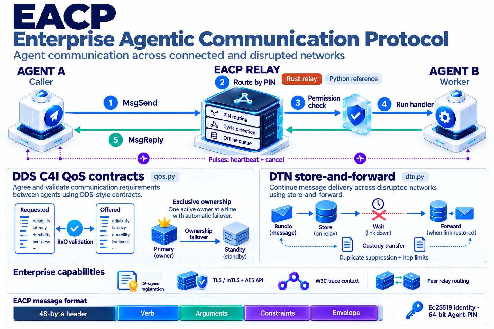

# EACP: Enterprise Agentic Communication Protocol

[](https://github.com/mrschneider/eacp/actions/workflows/ci.yml)


**EACP** is a microkernel-grade communication and coordination protocol for
enterprise multi-agent systems: deterministic cooperative concurrency and
capability-based security (PlatSec), synchronous rendezvous IPC (QNX Neutrino
discipline), and cryptographic PIN-routed push delivery.



## How one call flows

1. **`MsgSend`** — Agent A addresses Agent B's cryptographic **Agent-PIN**
   (64 bits derived from its Ed25519 key — never an IP or DNS name, so agents
   migrate across cloud/edge without breaking addressing) and blocks on
   rendezvous until replied.
2. **Route by PIN** — the **EACP-Relay** resolves the PIN, verifies the
   frame's Ed25519 signature in transit, and rejects deadlock cycles
   (`A→B→C→A`) before they can hang the mesh. Offline targets get TTL'd
   queues.
3. **Permission check (PlatSec)** — the frame's 64-bit capability bitmask is
   validated against Agent B's signed manifest *before* anything runs:
   insufficient capability means **denied**, with no LLM inference or tool
   ever invoked — prompt-injection privilege escalation becomes structurally
   impossible.
4. **Run handler** — execution happens under B's cooperative
   `ActiveScheduler` with the token budget escrowed upfront (over-budget work
   is refused before spending compute) and a hop guard against infinite
   delegation.
5. **`MsgReply`** — the result unblocks the caller and carries the
   *remaining* token budget, so the delegation tree shares one envelope.
   Every frame lands in a hash-chained audit ledger.

**Pulses** (heartbeat + cancel) are 8-byte out-of-band signals flowing
outside the rendezvous: they keep routes alive across flaky edge links and
cancel in-flight reasoning steps without blocking. Cancellation is real:
the dispatched handler is stopped at its await point, its token escrow is
refunded, and nothing keeps running after the caller's timeout.

### The message format

A fixed **48-byte binary header** (magic, version, message type, opcode,
flags, sender/target PIN, transaction ID, capability mask, status) followed
by four structured slots: **Verb**, **Arguments**, **Constraints** (token
budget, timeout, hop limit) and a cryptographic **Envelope** (Ed25519
signature + session handle). Binary, not JSON — deterministic, compact,
verifiable.

## Key pillars

1. **Deterministic concurrency (Active Objects)** — one single-threaded
   cooperative event loop per agent: no thread sprawl, no races, no
   uncontrolled token usage.
2. **Platform Security (PlatSec)** — a 64-bit capability bitmask validated
   at the protocol frame layer before any action or tool executes.
3. **Synchronous rendezvous (QNX Neutrino IPC)** — `MsgSend` /
   `MsgReceive` / `MsgReply` with built-in deadlock cycle detection.
4. **Agent-PIN cryptographic addressing** — global 64-bit addressing
   independent of IP/DNS, routed across cloud and edge by the EACP-Relay.

## Design guarantees

- **Prompt injection cannot escalate privileges** — PlatSec validation
  happens at the L2 protocol layer, before any LLM inference or tool
  invocation, and claimed capabilities are checked against the caller's
  CA-attested registration grants (delegated permissions may only
  decrease).
- **Circular deadlocks are refused** — the relay's `DeadlockGraph`
  rejects `MsgSend` cycles with `EACP_ERR_DEADLOCK_DETECTED` (edges are
  tracked per transaction, so concurrent calls cannot mask a cycle).
- **Signed traffic is enforced** — senders registered with a key must
  send Ed25519-signed frames (`EACP_ERR_SIGNATURE_INVALID` otherwise),
  replayed (sender, tx) transactions are refused
  (`EACP_ERR_REPLAY_DETECTED`), and registration demands proof of
  possession against the configured CA.
- **No zombie routes** — offline push queues respect per-message TTL and a
  global byte/frame budget with an explicit `EACP_ERR_QUEUE_FULL`
  refusal; heartbeat timeouts prune dead transports.
- **Deterministic resource cleanup** — `CleanupStack` releases protocol
  resources when `RunL()` leaves; reversing external side effects (API
  calls, database writes) remains the application's compensation or
  idempotency strategy.
- **Tamper-evident audit trail** — routed frames append to a hash-chained
  ledger that is recovered and verified across restarts (a hash chain is
  a mechanism, not legal non-repudiation or a SOC 2 / ISO 27001
  certification — those require external controls).
- **Language-portable by construction** — the wire contract is pinned by
  `conformance/`: byte-exact vectors any Scala/Rust/Go implementation must
  satisfy to join the mesh, enforced by CI on every push.

## Enterprise hardening

| Capability | Module | Description |
|---|---|---|
| Zero-Trust Encryption | `security.py` | AES-256-GCM payload confidentiality + mTLS/TLS 1.3 transport contexts |
| Observability | `telemetry.py` | W3C TraceContext distributed tracing + Prometheus/OpenMetrics exporter |
| Agent PKI | `security.py` | `EnterpriseCA` signs `SignedManifest`s; the relay verifies manifests against the CONFIGURED CA key with pin/key binding and proof of private-key possession |
| High Availability | `mesh.py` | Multi-Relay peer mesh routing across clouds/AZs/edges (experimental — see ARCHITECTURE §8.3) |
| Audit Trail | `ledger.py` | Append-only SHA-256 chained WAL ledger with startup recovery, chain verification and rotation (tamper-evident mechanism — not a compliance certification) |
| DoS Protection | `frame.py` | Strict 16 MB payload guard plus bounded decompression (wire and decompressed representations are both capped) |
| Wire Compression | `frame.py` | Transparent zlib compression of payloads > 1 KB (`FLAG_COMPRESSED`) |
| Keepalive | `relay.py` | `PULSE_HEARTBEAT` presence + dead-route reaper (3x missed → prune) |
| Hop Guard | `client.py` | `max_depth_hops` decremental enforcement prevents infinite agent delegation |
| Token Budget Escrow | `budget.py` | Kernel-style escrow/settle/refund ledger with pluggable `TokenMeter`, ledger capacity and `EACP_ERR_TOKEN_OVERFLOW` |
| Fail-Closed PlatSec | `security.py` | `strict_mode=True` rejects any action not registered in the manifest |
| DDS C4I QoS Contract | `qos.py` | Requested vs Offered (RxO) contract validation + exclusive ownership arbitration with failover (experimental) |
| DTN Store-and-Forward | `dtn.py` | RFC 9171 / DARPA Bundle Protocol custody transfer, duplicate suppression & hop limits (experimental) |

## Quickstart

Run the test suite (84 tests):

```bash
python3 -m unittest discover tests -v
```

Run the EACP-Relay daemon:

```bash
# native Rust relay (deterministic, zero GC)
cargo run --release --manifest-path crates/eacp-relay/Cargo.toml -- --port 8990

# or the portable pure-Python relay
python3 -m eacp.relay --host 0.0.0.0 --port 8990
```

> The **Python relay is the reference implementation** — CA verification,
> signature enforcement, audit ledger, mesh peering and TLS live there. The
> Rust relay is a performance candidate with a declared-grants gate; see
> [ARCHITECTURE §8.3](ARCHITECTURE.md) (qualification gaps) before treating
> the two as interchangeable.

Minimal agent example:

```python
import asyncio
from eacp import RSessionBase, MsgSend, Capability

async def main():
    server = RSessionBase(allowed_capabilities=Capability.CAP_DISK_READ)
    server.register_handler("query", lambda f: {"result": 42},
                            required_caps=Capability.CAP_DISK_READ)
    await server.connect(port=8990)

    client = RSessionBase(allowed_capabilities=Capability.CAP_DISK_READ)
    await client.connect(port=8990)

    reply = await MsgSend(client, target_pin=server.pin, verb="query",
                          data={"sql": "SELECT 1"})
    print(reply.data)  # {"result": 42}

    await client.close()
    await server.close()

asyncio.run(main())
```

## Layout

```
ARCHITECTURE.md     canonical protocol reference (wire format, PlatSec, scheduler, relay)
conformance/        cross-language wire contract: vectors + generator + strict verifier
crates/eacp-relay/  native Rust relay daemon (tokio, binary parser, deadlock engine)
src/eacp/           protocol core: frame · security · scheduler · primitives · relay ·
                    client · telemetry · ledger · mesh · budget · qos · dtn
tests/              9 suites: frame · security · scheduler · relay · budget ·
                    enterprise · tactical · rust_relay · protocol_hardening
bench/              relay benchmark harness (Python vs Rust, identical wire)
docs/               architecture diagram · benchmarks
```

Per-file map: [ARCHITECTURE.md — Appendix](ARCHITECTURE.md#appendix--directory-map).

## Documentation

- [ARCHITECTURE.md](ARCHITECTURE.md) — canonical protocol reference
  (wire format, PlatSec, scheduler, rendezvous semantics, relay, error codes)
- [conformance/CONFORMANCE.md](conformance/CONFORMANCE.md) — how to
  implement EACP in any language
- [docs/benchmarks.md](docs/benchmarks.md) — relay benchmarks (RTT
  p50/p95/p99, throughput, memory/conn, stalled-consumer recovery;
  Python vs Rust, methodology and honest gaps)
- [CONTRIBUTING.md](CONTRIBUTING.md) · [SECURITY.md](SECURITY.md)

## License

MIT.